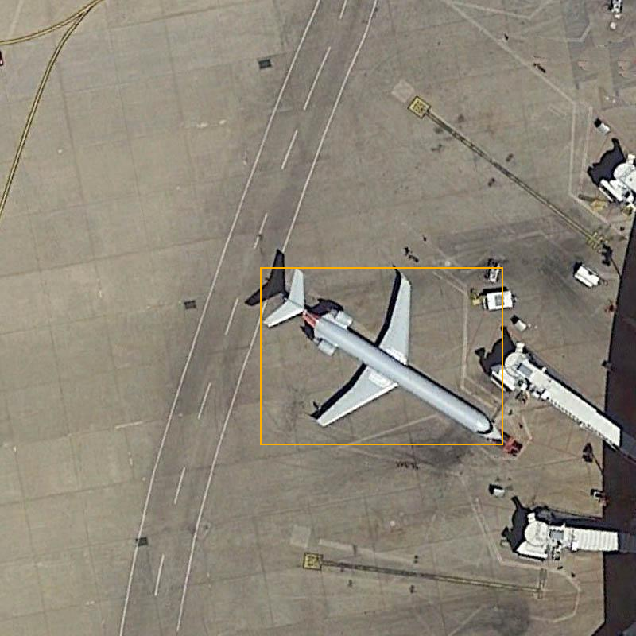
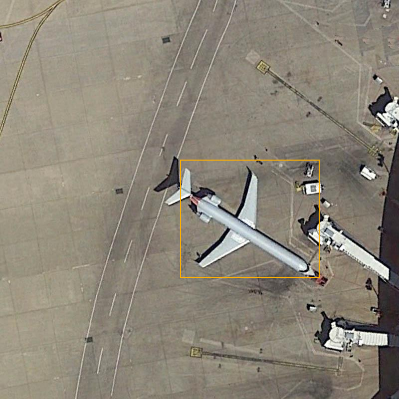
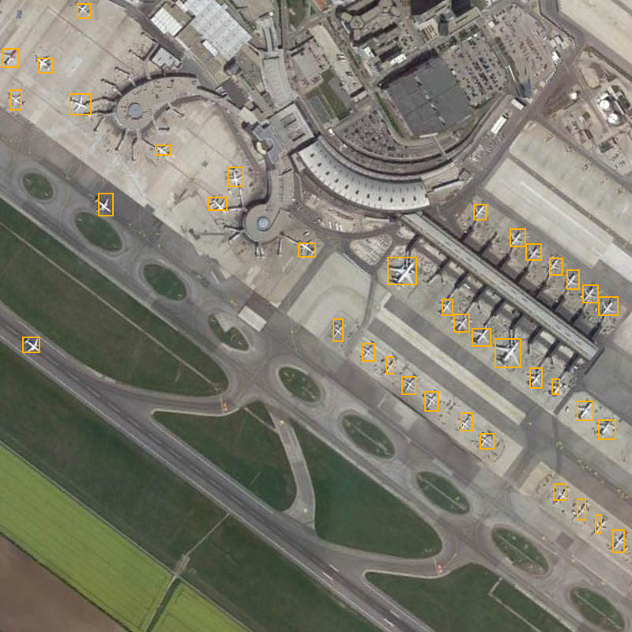
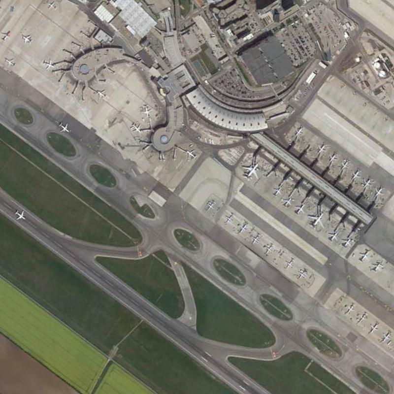

# Aircraft Detection

I am learning how to detect aircraft in aerial images using Python and PyTorch.
The project loads labeled images, runs a pretrained Faster R-CNN model, and
fine-tunes its detection layers to recognize aircraft.

## Examples before training

Orange boxes mark aircraft. Labels are the answers supplied by the dataset;
predictions are what the model finds.

| Dataset labels | Model predictions |
| --- | --- |
|  |  |
|  |  |

The model finds the large aircraft but misses the smaller ones in the second
image. In the three example images, it matched 4 of 69 labeled aircraft at a
confidence threshold of 0.5 and an overlap threshold of 0.5. This is a small demo,
not a benchmark. [Saved results](docs/baseline-report.json).

## Setup

Use Python 3.13 or newer. In PowerShell:

```powershell
python -m venv .venv
.venv\Scripts\python -m pip install torch torchvision --index-url https://download.pytorch.org/whl/cpu
.venv\Scripts\python -m pip install -e .
```

## Try the model

```powershell
.venv\Scripts\python scripts/fetch_sample.py
.venv\Scripts\python scripts/run_baseline.py
```

The first run downloads about 160 MB of model weights.
Open `outputs/baseline/` to see the predictions.

## Get more images

Run `fetch_sample.py` above first. Then choose one size:

| Size | Training | Validation | Test | Total |
| --- | --- | --- | --- | --- |
| starter | 40 | 10 | 10 | 60 |
| larger | 120 | 30 | 30 | 180 |

```powershell
.venv\Scripts\python scripts/prepare_data.py --size larger
.venv\Scripts\python scripts/check_data.py --size larger
```

Use `--size starter` for the smaller set. The sets go into separate folders:
`data/aircraft/` and `data/aircraft-larger/`. Completed downloads are reused.
The larger set is a separate selection, not 180 additional unique images.
Review the label pictures in `outputs/data_check_larger/` before training.
Downloading more images does not change the model or the three-image demo.

- **Training:** images the model learns from.
- **Validation:** images used to compare changes while learning.
- **Test:** images saved for the final check.

## Train the model

After preparing and checking the larger dataset:

```powershell
.venv\Scripts\python scripts/train.py --size larger --epochs 2 --run-name my_first_run
```

An **epoch** is one pass through the training images. The image-feature extractor
stays fixed while the detection layers learn. This runs on the CPU and may take
a while. Use a new run name each time so earlier results are not overwritten.

Look in `outputs/training/my_first_run/` for:

- `last.pt`: saved model weights after each completed epoch.
- `history.json`: average training loss (the model's training error).
- `before/` and `after/`: validation predictions and reports.
- `summary.json`: the before-and-after comparison after training finishes.

Lower training loss alone does not mean better detection. Compare matched
aircraft, missed aircraft, and false alarms on the same validation images.
The test set is not opened by the training script.

### First training result

Two epochs on 120 training images, checked on the same 30 validation images
before and after training. Confidence and overlap thresholds both stayed at 0.5.

| Validation result | Before training | After training |
| --- | --- | --- |
| Correctly detected aircraft | 37 | 164 |
| Missed aircraft | 244 | 117 |
| False alarms | 8 | 142 |

The trained model finds more aircraft, but also draws more incorrect boxes.
It is a tradeoff, not an improvement in every measure. These are validation
results, not final test results or mAP. [Run details](docs/training-summary.json).

Try your saved model on an image:

```powershell
.venv\Scripts\python scripts/predict.py --checkpoint outputs/training/my_first_run/last.pt --image data/sample/2003.jpg
```

## What I will try next

1. Check that aircraft boxes are correct, including small aircraft.
2. Inspect the false alarms from this first training run.
3. Compare confidence thresholds on validation data to reduce false alarms.
4. Change one thing at a time and record what improved or got worse.

Good data includes different aircraft sizes, backgrounds, and images with no
aircraft. More images alone do not guarantee better results. Keep similar scenes
out of different splits when possible; the current checks remove exact duplicates,
not all similar scenes. Do not combine the starter and larger sets across splits.

## Data and tests

Source: [DIOR mirror](https://huggingface.co/datasets/HichTala/dior), based on
[DIOR](https://arxiv.org/abs/1909.00133). These small selections use the mirror's
splits, not verified official benchmark splits. The mirror does not declare a
license; imagery rights remain with their owners. Full datasets and model
weights are not committed.

```powershell
.venv\Scripts\python -m unittest discover -s tests -v
```
