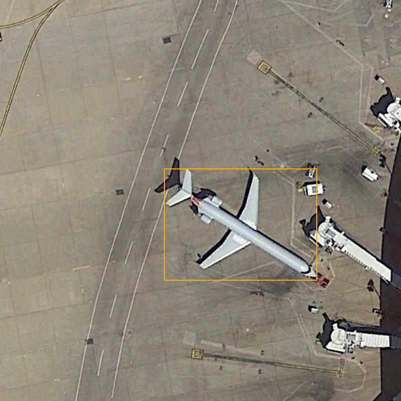
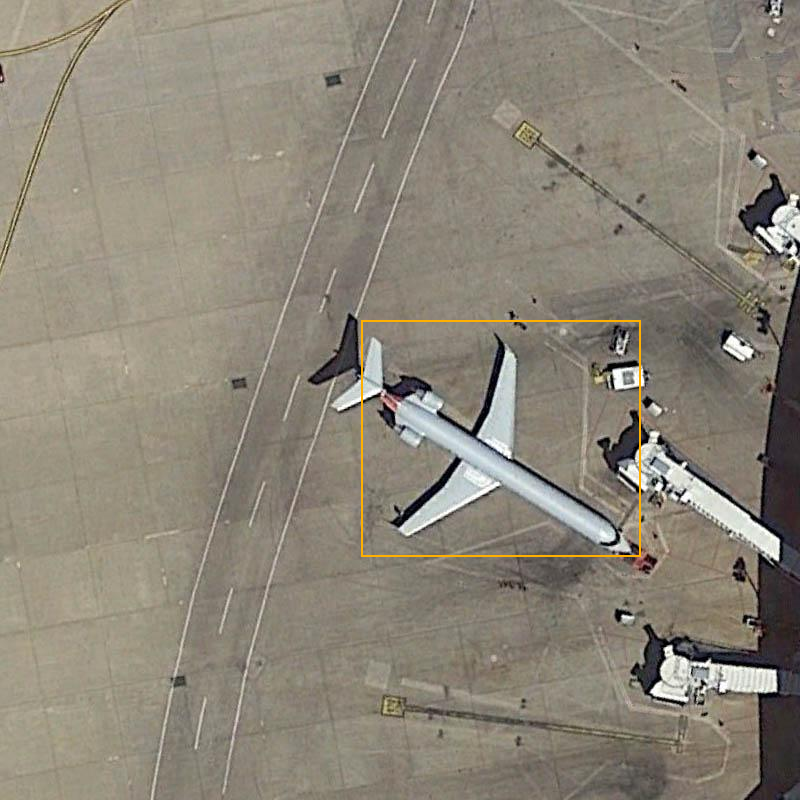
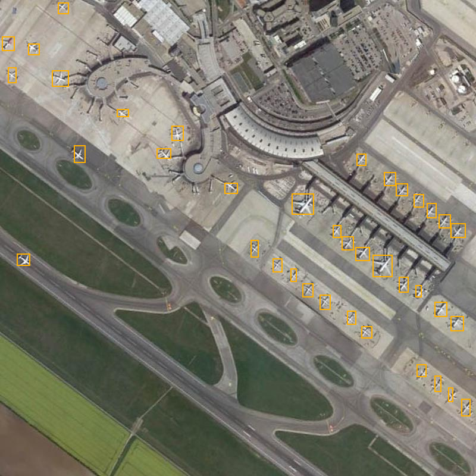
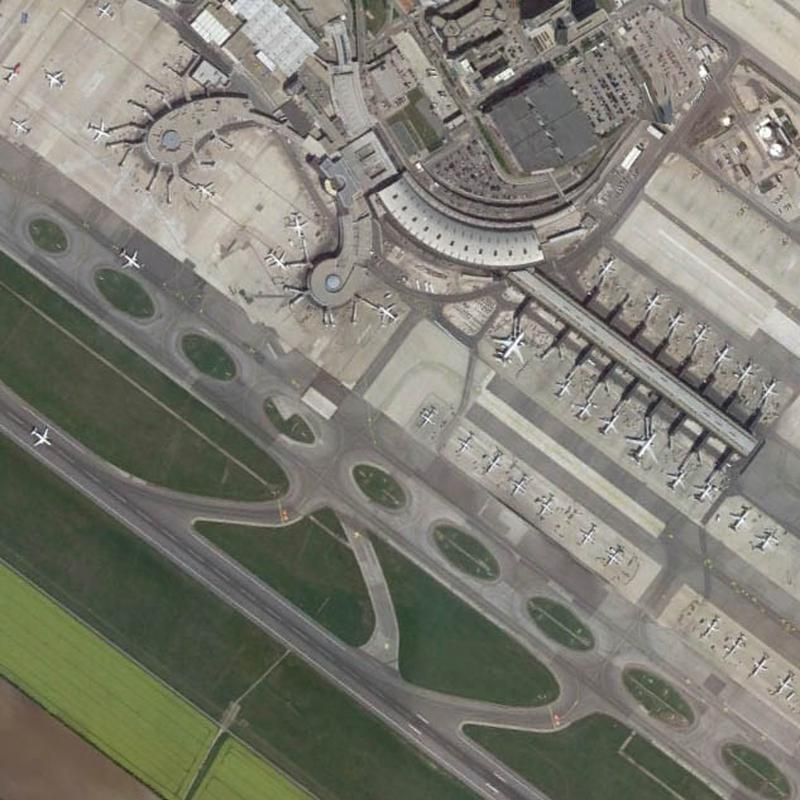

# Aircraft Detection

A learning project for detecting aircraft in overhead images with PyTorch and
TorchVision. It includes a dataset loader, annotation checks, and a pretrained
Faster R-CNN baseline. The published code does not yet include fine-tuning.

## Examples

Orange boxes show dataset annotations on the left and model predictions on the
right. These are actual outputs from the existing COCO-pretrained baseline.

| Dataset annotations | Model predictions |
| --- | --- |
|  |  |
|  |  |

The large aircraft is detected, but the model misses all 38 annotated aircraft
in the second image. This illustrates why an off-the-shelf detector needs to be
evaluated carefully on overhead imagery.

Across the three selected demonstration images, the saved run matched **4 of 69
annotated aircraft**, with 0 unmatched predictions, at confidence and IoU
thresholds of 0.5. These are inspection results, **not a held-out benchmark or
mAP score**. See the [saved report](docs/baseline-report.json).

## Setup

Python 3.13+; Windows PowerShell, CPU setup:

```powershell
python -m venv .venv
.venv\Scripts\python -m pip install torch torchvision --index-url https://download.pytorch.org/whl/cpu
.venv\Scripts\python -m pip install -e .
```

## Run the baseline

```powershell
.venv\Scripts\python scripts/fetch_sample.py
.venv\Scripts\python scripts/inspect_sample.py
.venv\Scripts\python scripts/run_baseline.py
```

The first baseline run downloads approximately 160 MB of pretrained weights.
Annotated images, predictions, and a JSON report are saved in `outputs/baseline/`.
No model training happens in this step.

## Prepare the starter dataset

Run `fetch_sample.py` first, then:

```powershell
.venv\Scripts\python scripts/prepare_data.py
.venv\Scripts\python scripts/check_data.py
.venv\Scripts\python -m unittest discover -s tests -v
```

This prepares 40 training, 10 validation, and 10 test images, including images
without aircraft annotations. Checks cover valid boxes, image checksums, exact
duplicates, and batching. The three demonstration images are excluded.

## Data

Images and annotations come from the [HichTala/dior mirror](https://huggingface.co/datasets/HichTala/dior)
of [DIOR](https://arxiv.org/abs/1909.00133). Example images above are derived from
that dataset; imagery rights remain with their respective owners. The mirror
does not declare a license, and this repository does not grant rights to reuse
the source imagery.

The starter selection uses the mirror's splits, not a verified reproduction of
the official benchmark. It is small and selected by fixed positive/negative
quotas; geographic separation and near-duplicate removal are not guaranteed.
Full datasets, weights, and generated output folders stay out of Git.

## Next steps

- Fine-tune the detector on the starter training set and inspect validation errors.
- Compare confidence thresholds on validation data, keeping test data separate.
- Investigate missed small aircraft, including a controlled experiment with tiling.
- Evaluate on a larger, representative held-out set before making performance claims.
